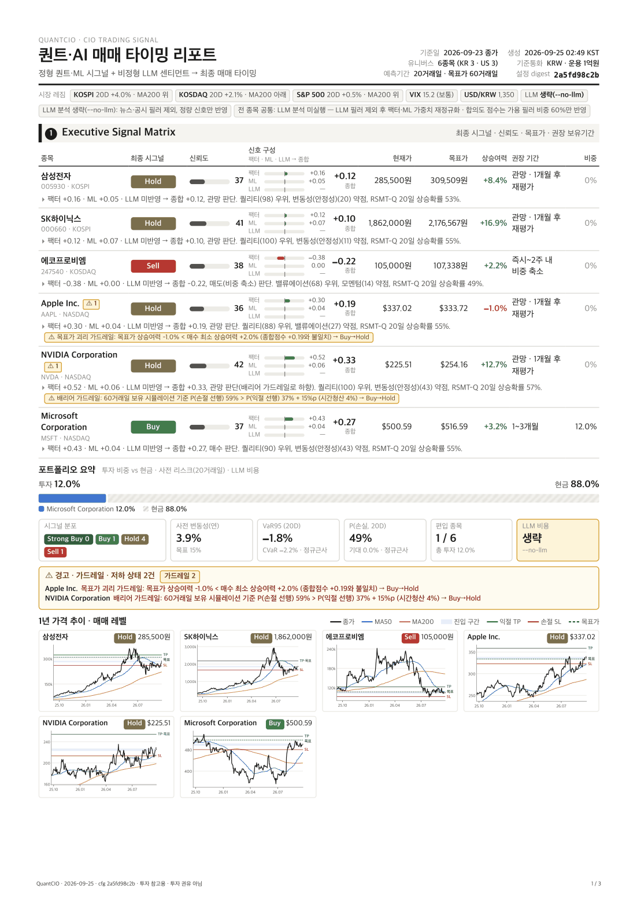

# QuantCIO — 한국·미국 주식 리서치 파이프라인

시점별(point-in-time) 데이터 구축부터 모델 선정, 사전 선언 검증, PDF 리포트까지 혼자 만든 주식 리서치 시스템입니다.
이 저장소에서 보여 드리고 싶은 것은 수익률 숫자가 아니라 **결과를 믿을 수 있게 만드는 절차**와, 그 절차를 지키는 **코드**입니다.

- 무료 공개 데이터만으로 한국(KOSPI+KOSDAQ)과 미국(S&P 500)의 시점별 유니버스를 만들었습니다. 상장폐지·인수 종목을 포함합니다.
- 모든 연구는 판정 기준을 실행 전에 문서에 적고 시작했습니다. 100개가 넘는 실험 중 대부분은 "효과 없음"으로 끝났고, 그대로 기록했습니다.
- 한국에서는 튜닝에 한 번도 쓰지 않은 10년 구간에서 확인된 신호를 하나 찾았습니다. 미국에서는 찾지 못했고, 그렇게 결론 냈습니다.
- 소스 6.3만 줄, 테스트 1,418개(2.7만 줄), CI에서 린트와 테스트를 돌립니다.

<p align="center"></p>

<sub>리포트 1쪽 예시입니다. 합성 자료로 만든 전체 샘플(3쪽)은 [docs/assets/sample_report.pdf](docs/assets/sample_report.pdf)에 있습니다.</sub>

## 1. 검증 원칙

| 원칙 | 구현 |
|---|---|
| 그 시점에 알 수 있던 정보만 쓴다 | 월말마다 유니버스를 다시 구성합니다. 재무는 최초 공시 값과 공시일 다음 거래일(`available_from`)을 씁니다. 상장폐지 종목은 마지막 거래가로 끝냅니다. |
| 기준을 먼저 적는다 | 가설·지표·통과 기준을 [docs/MODELING.md](docs/MODELING.md)에 시각과 함께 적은 뒤 실행합니다. 결과를 본 뒤의 계산은 "사후"라고 표시합니다. |
| 기준을 나중에 바꾸지 않는다 | 미국 모멘텀 신호는 t 2.79로 기준 2.8에 0.01 모자라 탈락시켰습니다(103절). |
| 본 적 없는 자료로 확인한다 | 걷기 검증(walk-forward) 바깥 구간, 마지막 24개월 확인 구간, 튜닝에 쓰지 않은 종목군(401~600위), 그리고 실제 미래(전진 검증)로 나눠 봅니다. |
| 코드가 바뀌면 확인도 무효다 | 전진 검증을 등록할 때 신호 코드의 지문과 설정 다이제스트를 함께 기록합니다. 하나라도 바뀌면 그 등록은 자동으로 무효가 됩니다([docs/HOLDOUT.md](docs/HOLDOUT.md)). |
| 과거 자료가 조용히 바뀌지 않게 한다 | 가격·재무·거시 자료를 기준일로 고정해 두고(vintage), 고정 구간의 특징·정답 지문이 달라지면 실행을 멈춥니다. |
| 비용과 위험을 같이 본다 | 모든 장부에 거래비용을 넣고, 최대 낙폭과 "가장 좋았던 10개월을 뺀 수익"을 같이 적습니다. |

## 2. 대표 결과

숫자의 출처는 모두 [docs/MODELING.md](docs/MODELING.md)의 해당 절입니다.

### 확인된 것

| 내용 | 결과 | 절 |
|---|---|---|
| 한국 상위 5% 장부(랜덤포레스트, 월 1회 교체) | 2019-03~2026-07 연 +34.1%(비용 50bp 후), 전체 평균 +13.1%. 최대 낙폭 −31%, 최고 10개월을 빼면 연 +10.7% | 94, 96 |
| 같은 방식의 옛 구간 확인(2005-07~2015-12, 모델 고르기에 쓰지 않은 구간) | 연 +20.1%(50bp 후), 전체 대비 t 3.40. 시장 대비 알파 연 +14.1%(t 3.61), 베타 0.91 | 100 |
| 3개월 모델·3개월 보유(월 교체 약 20%) | 옛 구간 연 +19.0%, t 3.13 | 101 |
| 수익률 분포 모형(RSMT-Q) | 80% 구간 적중 약 81%, VaR 95% 초과 약 5%. 방향 예측은 기준보다 낫지 않아 위험·비중 계산에만 씁니다 | [RSMT.md](docs/RSMT.md) |

위 한국 장부는 리포트에 "참고"로만 표시하고 신호와 비중에는 쓰지 않습니다. 결과를 본 뒤 고른 모델이고, 수익이 소수의 급등 달에 몰려 있기 때문입니다.

### 효과가 없다고 결론 낸 것

| 가설 | 결과 | 절 |
|---|---|---|
| 미국 S&P 500에서 ML로 종목 선택 | 39개 모델 중 사전 기준을 넘은 모델 없음. 모델 점수는 사실상 저베타 선택이었고, 베타를 빼면 알파가 0 근처 | 95, 97 |
| 미국: 60년치 외부 자료(프렌치 라이브러리)로 신호를 먼저 고르기 | 대형주 매수 쪽 12개 신호 중 통과 없음 | 103 |
| 뉴스·공시·LLM 특징, 거시·무역·신용 자료 추가 | 여러 묶음 모두 표본 외 개선 없음 | 53~78 |
| 하이퍼파라미터 탐색과 정규화(10개 모델군) | 학습 자료를 외우는 정도는 줄지만 표본 외 성능은 그대로 | 82, 83 |
| 최근 N년만으로 학습(롤링 창) | 도움 없음. 3년 창은 오히려 나쁨(t −2.09) | 101 |
| 2002년부터 길게 학습 | 최근 구간 성과가 나빠짐(t −2.07). 신호의 모양이 시대마다 다름 | 100 |
| 복잡한 모델 대 12-1 모멘텀 | 재실행마다 순위가 바뀜. 같은 설정의 실행 간 AUC 차이(약 0.008)를 따로 재서 잡음 범위로 판정 | 57, 84 |

### 스스로 찾아 고친 오류

- **결측 누수:** 한국 201~400위 종목에서 수급 특징 7개의 결측 여부가 정답과 연결돼 성능이 좋아 보였습니다. 원인을 찾아 해당 개선을 취소하고 특징 묶음 검사를 추가했습니다(86절).
- **지표의 편향:** 로그 수익 정답과 순위 지표의 조합이 저변동성 종목을 구조적으로 유리하게 평가했습니다. 평가 기준을 "실제 장부의 비용 후 수익"으로 바꿨습니다(78, 79절).
- **미국 재무 수집 오류:** SEC 목록 페이지 처리 오류와 뒤늦게 올라온 재무 자료가 과거 값을 바꾸고 있었습니다. 자료 고정(vintage)을 도입한 계기입니다(84절).
- **확인 무효 처리:** 한국 모델의 종목군 확인을 받은 뒤 모델 코드를 고쳤고, 규칙대로 확인을 무효로 돌린 뒤 다시 받았습니다([HOLDOUT.md](docs/HOLDOUT.md)).
- **미국 생존 편향:** 과거 S&P 500 구성 785종목 중 178개(구성원-월의 약 13%)가 인수·상장폐지 뒤 가격 자료에서 빠져 있었습니다. SEC 결제실패(FTD) 기록의 원가격과 대조해 메우는 중입니다(103, 104절). <!-- TODO: 104절 결과가 확정되면 한 줄로 갱신 -->

## 3. 시스템 구성

```
데이터 수집 ─▶ 시점별 유니버스·재무 ─▶ 특징·정답 ─▶ 모델 선정 ─▶ 서빙 ─▶ 신호 결합 ─▶ 리포트
 (KRX, DART,    (data/pit, vintage)     (modeling)   (걷기 검증,    (게이트,    (fusion,     (PDF·HTML·JSON)
  SEC, Yahoo)                                         확인 구간)     배수)      risk)
                                             └─ 홀드아웃 등록 · 전진 원장 (holdout, tracking)
```

| 경로 | 내용 |
|---|---|
| `src/quantcio/data/pit/` | 한국·미국 시점별 유니버스와 재무. 미국은 SEC CIK로 종목을 추적하고, 코드 재사용·분할·상장폐지를 SEC 기록으로 대조합니다. |
| `src/quantcio/data/vintage.py` | 기준일 고정과 지문 검사 |
| `src/quantcio/modeling/` | 특징, 후보 모델(선형·트리·부스팅·신경망·RSMT), 선정 프로토콜, 서빙 |
| `src/quantcio/quant/`, `backtest/` | 수익률 분포 모형(RSMT-Q), 팩터 모델과 백테스트 |
| `src/quantcio/holdout.py`, `tracking.py` | 홀드아웃 등록·무효 판정, 전진 기록 |
| `src/quantcio/fusion/`, `report/` | 신호 결합, 손절·익절·비중 계산, 리포트 렌더링 |
| `scripts/` | 연구 스크립트. 파일 이름의 번호가 MODELING.md의 절 번호입니다. |
| `tests/` | 단위·통합 테스트 1,418개. 네트워크 없이 고정 자료로 돕니다. |

설계 설명은 [docs/ARCHITECTURE.md](docs/ARCHITECTURE.md), 사용법은 [docs/GUIDE.md](docs/GUIDE.md)에 있습니다.

## 4. 직접 돌려 보기

```bash
python -m venv .venv && source .venv/bin/activate
pip install -e ".[dev]"
pytest -m "not live"                 # 네트워크 없이 도는 전체 테스트(CI와 같은 명령)
quantcio doctor                      # 환경 점검 + 합성 자료로 샘플 리포트(reports/doctor/sample_report.pdf)
```

실제 자료로 돌리려면 `.env.example`을 복사해 SEC 사용자 정보와 OpenDART 키 등을 넣습니다. 자료는 저장소에 들어 있지 않고, 각 출처에서 직접 받도록 되어 있습니다.

## 5. 한계

- 일봉 종가 기준입니다. 체결 충격, 호가 차이, 공매도 제약은 고정 비용(bp)으로만 반영했습니다.
- 한국 신호의 최근 구간 성과는 사후 선택이 섞여 있습니다. 독립적인 근거는 2005~2015년 구간 확인 하나이며, 전진 검증은 2026-11-12에 등록해 표본을 쌓는 중입니다.
- 무료 자료의 한계가 있습니다. 미국은 2012년 이후만 다루고, 일부 인수 종목의 가격은 끝내 구하지 못했습니다.
- 실제 자금을 운용한 기록이 아닙니다. 투자 권유가 아닙니다.

## 6. 데이터와 라이선스

- 코드는 MIT 라이선스입니다.
- 외부 자료(KRX, DART, SEC EDGAR, Yahoo, Kenneth French Data Library, Tiingo 등)는 각 제공자의 이용 조건을 따르며 이 저장소에 포함하지 않았습니다.

## 7. 작업 방식

<!-- TODO: 본인 말로 채울 것. 예: 연구 질문, 판정 기준, 채택·기각 결정은 직접 했고, 구현과 문서 작성에 AI 코딩 도구(Claude Code)를 썼습니다. -->

## 더 읽을 것

- [docs/MODELING.md](docs/MODELING.md) — 전체 연구 기록(사전 선언과 결과, 약 6,000줄)
- [docs/EVALUATION.md](docs/EVALUATION.md) — 평가 방법과 생존 편향 측정
- [docs/HOLDOUT.md](docs/HOLDOUT.md) — 홀드아웃 등록부와 무효 규칙
- [docs/RSMT.md](docs/RSMT.md) — 수익률 분포 모형
