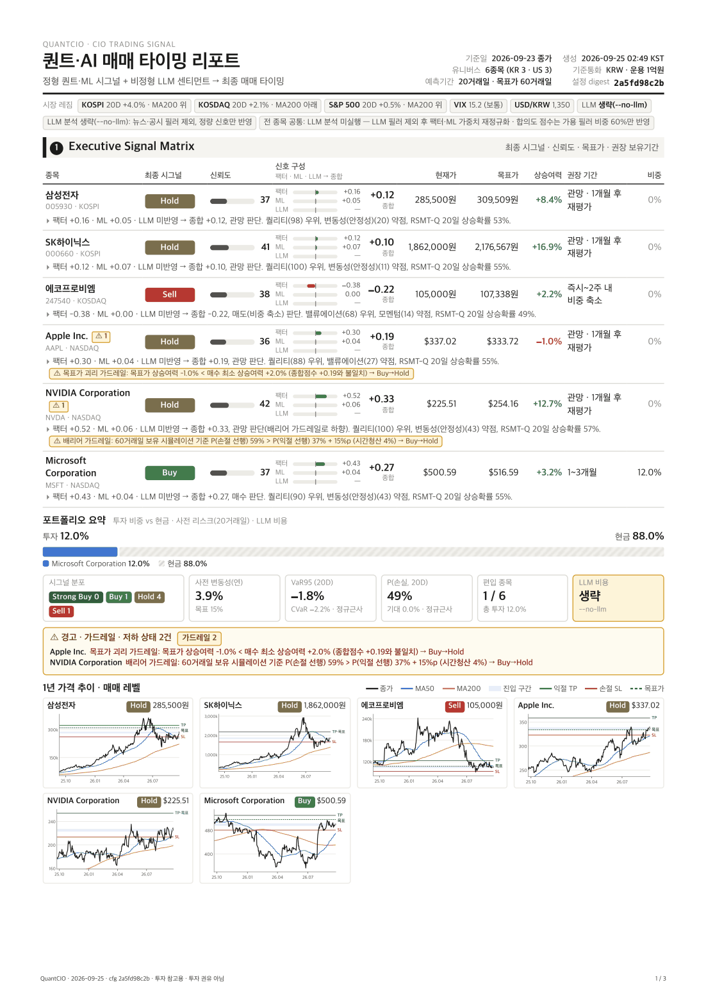

# QuantCIO — 퀀트 + LLM 매매 타이밍 리포트 (KR · US)

> 이 문서는 도구 사용 설명서입니다. 프로젝트 개요와 최신 검증 결과는 [README](../README.md)에 있습니다.
> 아래 1절의 검증 상태 표는 2026-10-12 기준이며, 그 뒤의 변경은 [MODELING.md](MODELING.md)에 있습니다.

한국·미국 주식 종목 코드를 넣으면 **A4 3쪽 안팎의 PDF 리포트**(한국어 기본, `--lang en`이면 영어)를 만드는 CLI 도구입니다.
종목마다 최종 시그널(Strong Buy / Buy / Hold / Sell), 신뢰도, 목표가, 손절·익절가, 권장 비중이 들어갑니다.
숫자(신호·가격·비중)는 모두 코드가 결정론적으로 계산하고, LLM(Claude)은 뉴스 채점·공시 요약·비평만 맡습니다. LLM이 결과에 주는 영향에는
코드로 정한 상한이 있고, `--no-llm`으로 끌 수 있습니다.

> **[정형 퀀트 신호] + [비정형 LLM 센티먼트] = [최종 매매 타이밍]**

**하는 일**
- KR·US 종목의 가격·재무·뉴스·공시를 무료 공개 소스에서 모읍니다.
- 다섯 가지 팩터 점수, 시점별(PIT) 멀티팩터 모델, 종목 선택 모델(같은 날 다른 종목보다 나을지), 수익률 분포 모형(RSMT-Q), 선택적인 LLM 분석을
  하나의 시그널로 합칩니다. 매크로 레짐(글로벌·미국·한국)은 총 투자 한도만 조절합니다.
- 진입 구간, 종가 기준 손절, 익절, 60거래일 청산 확률, Kelly 상한, 포트폴리오 비중을 계산합니다.
- 결과를 PDF·HTML·JSON으로 저장하고, 대체 소스·결측·모형 저하·가드레일을 리포트에 표시합니다.
- 검증 도구(표본 외 평가, 팩터 백테스트, 종목 선택 모델 선정, 홀드아웃·전진 추적)가 함께 있습니다. 리포트를 만들 때마다 예측이 git이 추적하는
  원장(`holdout/ledger/`)에 남습니다.

**하지 않는 일**
- 주문을 내거나 증권사와 연동하지 않습니다. 장중 데이터를 쓰지 않습니다(일봉 종가 기준).
- 수익을 보장하는 모형이 아닙니다([1절](#1-지금의-검증-상태-2026-10-12)). 리포트의 Buy/Sell을 그대로 따른 포트폴리오 백테스트는 없습니다.
- 유료 데이터를 쓰지 않습니다. 일부 소스는 비공식 경로라 예고 없이 바뀔 수 있습니다.

<p align="center"><a href="assets/report_page1.png"></a></p>

<sub>2026-09-25에 `--no-llm`으로 만든 리포트의 1쪽입니다. 이후 매크로 스트립·팩터 모델 표·백테스트 요약이 추가됐습니다. 각 칸의 뜻과 나머지 쪽은
[docs/GUIDE.md 1절](GUIDE.md#1-리포트-읽는-법)에 있습니다.</sub>

## 목차

1. [지금의 검증 상태](#1-지금의-검증-상태-2026-10-12)
2. [빠른 시작](#2-빠른-시작)
3. [리포트 만들기](#3-리포트-만들기)
4. [리포트 구성](#4-리포트-구성)
5. [신호가 만들어지는 방식](#5-신호가-만들어지는-방식)
6. [명령어 한눈에 보기](#6-명령어-한눈에-보기)
7. [설정과 환경 변수](#7-설정과-환경-변수)
8. [출력물·캐시·로그](#8-출력물캐시로그)
9. [운영 주기 — 모델 갱신과 전진 기록](#9-운영-주기--모델-갱신과-전진-기록)
10. [검증·연구 문서와 연구 스크립트](#10-검증연구-문서와-연구-스크립트)
11. [프로젝트 구조](#11-프로젝트-구조)
12. [개발](#12-개발)
13. [자주 겪는 문제](#13-자주-겪는-문제)
14. [한계와 면책](#14-한계와-면책)

자세한 설명(리포트 각 칸, 계산식, 명령별 모든 옵션, 설정 키 전체, 캐시, FAQ)은 **[docs/GUIDE.md](GUIDE.md)** 에 있습니다.

---

## 1. 지금의 검증 상태 (2026-10-12)

모든 검증은 그 시점에 알 수 있던 정보만 쓰고(시점별 유니버스, 상장폐지 포함), 표본 외·홀드아웃 구간으로 판정합니다. 판정 규칙은 실행 전에 문서에 적었습니다.

| 구성 요소 | 현재 상태 | 리포트에서의 쓰임 |
|---|---|---|
| **RSMT-Q** (20거래일 수익률 분포) | 분포 품질 게이트 통과(KR·US): 기준 모형보다 분포 오차(CRPS)가 작고, 80% 구간 적중 약 81%, VaR95 초과 약 5%. 방향(오를지)은 기준보다 낫지 않음 | 변동성·꼬리·VaR·손절/익절 확률·Kelly 등 **위험과 사이징** |
| **종목 선택 모델 KR** | `et`(엑스트라 트리). 표본 외 날짜 내 AUC 0.539 [0.518, 0.559], 순위 상관 IC +0.069 (t 3.4), 최근 24개월 0.542. 튜닝에 쓰지 않은 401~600위 종목에서 **확인**(XSH-KR-20261003, 같은 구간 전체 AUC 0.552) | 초과수익 기대치(서빙 배수 0.80). 정보의 핵심은 **변동성 큰 종목 피하기**이며, 비용 후 상위 20% 매수만으로는 초과수익이 유의하지 않음 |
| **종목 선택 모델 US** | `cat_rank`(CatBoost 순위, v9 입력, 2026-10-05 사용자 결정). AUC 0.513 [0.497, 0.529], 게이트 미달 | 참고용(배수 0.17) |
| **PIT 팩터 모델** | KR `ic_weighted_raw` 스킬 통과(밸류 +, 3·6개월 모멘텀은 반전 −). US `rsmt_tree` 미달(유의한 팩터 없음) | 팩터 필러에 50% 혼합(미달이면 ×0.35) |
| **매크로 오버레이** | 10년 백테스트에서 수익 개선 없음(샤프 KR +0.01, US +0.03) | 총 투자 한도만 줄임(리스크 관리용) |
| **시장 방향** | 거시 변수 모형이 두 시장 모두 기준률보다 나쁨 | 기준률(축소한 장기 평균) 사용 |
| **LLM 필러**(가중 40%) | 과거 시점의 뉴스·LLM 응답이 없어 과거 검증 불가 | 전진 홀드아웃 `FTH-20261005`로만 판정(표본 누적 중) |

- **연구 결과(v4~v16)**: 대체 자료(공시·수급·차트 지표·사회 지표·원자재·배당·휴일·본사 위치·논문·세금·보조금·법적 제재·회사채 등), 모델 33종,
  다중 분류·예측 기간 변경을 시험했지만 **서빙 모델보다 나아진 것은 없었습니다**([docs/MODELING.md](MODELING.md) 18~39절).
- 따라서 리포트의 Buy/Sell은 **검증된 수익 예측이 아니라 규칙에 따른 요약**입니다. 투자 판단은 사용자 책임입니다([14절](#14-한계와-면책)).

---

## 2. 빠른 시작

**요구 사항**
- **Python 3.12 이상**(PEP 695 문법과 `datetime.UTC`를 씁니다), macOS 또는 Linux, 인터넷 연결, 디스크 여유 수 GB(시점별 데이터 캐시 약 2GB 이상).
- **macOS**: LightGBM·XGBoost가 OpenMP 런타임을 찾지 못하면 `brew install libomp`를 실행하십시오.
- **Linux**: 한글 글꼴이 필요합니다(예: `sudo apt install fonts-noto-cjk`). 없으면 PDF의 한글이 네모로 나옵니다. 영어 리포트에도 한국어 인용이 남으므로 똑같이 필요합니다.
- 명령은 **저장소 루트에서** 실행하십시오(출력 폴더 `reports/`가 현재 위치 기준입니다).

**① 설치**

```bash
git clone <repo-url> quant && cd quant
python3.12 -m venv .venv
.venv/bin/pip install -e ".[dev]"
source .venv/bin/activate        # 이후 `quantcio`를 바로 쓰려면
```

**② PDF 엔진**: 설치된 Google Chrome을 먼저 씁니다. 없으면 `.venv/bin/python -m playwright install --only-shell chromium`.

**③ 키 설정**: 저장소 루트의 `.env`에 **자신의 값만** 넣습니다(`.env`는 커밋되지 않습니다). 변수 목록은 `.env.example`에 있고, 그 파일에는 실제 키를 넣지 마십시오.

| 변수 | 필요한 경우 | 없으면 |
|---|---|---|
| `ANTHROPIC_API_KEY` | LLM 분석(뉴스·공시·비평) | `--no-llm`으로 실행해야 합니다(그냥 실행하면 데이터를 받기 전에 `LLM 초기화 실패`로 멈춤) |
| `ANTHROPIC_WORKSPACE_ID` | 워크스페이스에 속하지 않은 **조직 단위 키**를 쓸 때만 | 보통 비워 둡니다. 그런 키로 비워 두면 API가 `400 … not scoped to a workspace`로 거부 |
| `SEC_USER_AGENT` | 미국 공시·XBRL, 미국 시점별 유니버스·재무(백테스트·종목 선택 모델). 형식 `"회사명 연락처@도메인"` | 미국 공시가 빠지고, 미국 백테스트·모델 갱신이 실패 |
| `DART_API_KEY` | 선택. 한국 공시(OpenDART), 시점별 재무의 공시 접수일, 한국 대체 자료 | 키 없는 DART 웹 검색으로 대체(느림, 요청 간격 6초) |
| `SARAMIN_API_KEY` / `WORK24_API_KEY` | 선택. 채용 공고 전진 기록(`quantcio alt jobs`) | 기록하지 않음(모델에는 영향 없음) |

연구 스크립트용 키(FRED·ECOS·KRX 등)는 [10절](#10-검증연구-문서와-연구-스크립트)에 있습니다. 리포트에는 필요 없습니다.

**④ 환경 점검**

```bash
.venv/bin/quantcio doctor          # 키 유무, Claude API(비용 없는 호출), Chrome, KR·US 소스 접속, 샘플 PDF
```

`FAIL`이 하나라도 있으면 종료 코드 1입니다. 샘플은 `reports/doctor/sample_report.pdf`(LLM 카드까지 채운 합성 데이터)입니다.

**⑤ 첫 리포트 (LLM 없이, 원장 기록 없이)**

```bash
.venv/bin/quantcio report --tickers 005930,000660,AAPL,NVDA --no-llm --no-record --open
```

- 새로 클론한 저장소의 첫 실행은 시점별 데이터(한국 marcap 연도별 파일, 미국 S&P 500 구성 이력·가격·XBRL)를 받느라 **수십 분** 걸립니다.
  이후에는 캐시를 써서 빨라집니다. 다만 RSMT-Q 시장 모델은 7일마다 다시 적합하고, 그때는 수십 분 걸릴 수 있습니다([9절](#9-운영-주기--모델-갱신과-전진-기록)).
- 백테스트·종목 선택 모델 캐시가 아직 없으면 `팩터 백테스트 캐시(KR) 없음 …`, `종목 선택 모델(KR) 서빙 산출물 없음 …` 알림과 함께 해당 블록 없이
  만들어집니다(⑦).

**⑥ LLM을 켜고 실행 (선택)**: `--no-llm`을 빼면 됩니다. 처음에는 한 종목으로 비용을 확인하십시오(종목당 약 $0.2~0.35, 같은 입력은 캐시로 무료).

```bash
.venv/bin/quantcio report -t 005930
```

**⑦ 백테스트·종목 선택 모델 캐시 만들기 (선택, 오래 걸림)**

```bash
caffeinate -i .venv/bin/quantcio backtest --market KR           # 팩터 백테스트 (KR)
caffeinate -i .venv/bin/quantcio backtest --market US           # 빈 캐시에서 30~45분
caffeinate -i .venv/bin/quantcio modeling select --market KR    # KR 종목 선택 모델
caffeinate -i .venv/bin/python scripts/us_v9_serve.py           # US 종목 선택 모델(v9 cat_rank)
```

- **US 종목 선택 모델은 `quantcio modeling select --market US`로 만들지 마십시오.** 그 명령은 v3 후보로 다시 골라, 서빙 중인 v9 `cat_rank`를
  덮어씁니다.
- `caffeinate -i`(macOS)는 실행 중 잠자기를 막습니다. 덮개를 닫거나 배터리가 바닥나면 그래도 잠들 수 있으니 전원을 연결해 두십시오.
  체크포인트가 있어 끊겨도 다시 실행하면 이어서 계산합니다.

---

## 3. 리포트 만들기

```bash
quantcio report                                              # config/watchlist.txt의 종목
quantcio report --tickers 005930,000660,AAPL,NVDA --capital 100000000
quantcio report --no-llm                                     # LLM 없이(비용 0, 빠름)
quantcio report --top 5 --markets KR                         # KR 모델 점수 상위 5종목
quantcio report --top 3 --bottom 2                           # 시장별 상위 3 + 하위(회피 후보) 2
quantcio report --tickers AAPL,NVDA --base USD --capital 50000 --open
quantcio report -t 005930,AAPL --lang en --no-record         # 영어 리포트, 원장에 기록하지 않음
quantcio analyze 035720 --no-llm                             # 한 종목, 콘솔 출력만(파일·원장 없음)
```

- **종목 결정 순서**: `--tickers` → `--watchlist` → 모델 선정(`--top`/`--bottom`)을 합치고 중복을 뺍니다. 셋 다 없을 때만 `config/watchlist.txt`를 씁니다.
  `--top`/`--bottom`은 종목 선택 모델 산출물의 최신 단면(KR 시가총액 상위 200, US S&P 500)에서 고릅니다.
- **`--no-llm`**: 뉴스·공시를 모으지 않고 LLM 필러를 뺀 뒤 팩터·ML 가중치를 다시 나눕니다(약 0.58 / 0.42). 리포트에는 "LLM 분석 미실행"이 한 번 표시됩니다.
- **출력**: `reports/<YYYYMMDD_HHMM>/quantcio_report_<…>.{pdf,html,json}`(시각은 KST). 같은 분에 다시 실행하면 덮어씁니다(`--out`으로 다른 폴더).
- **원장 기록**: 실제 리포트는 `holdout/ledger/predictions.jsonl`에 한 줄씩 남습니다. 시험 실행은 `--no-record`(또는 `QUANTCIO_NO_RECORD=1`)를 붙이십시오.
- **한국 종목은 20:00 KST 이후**에 실행하는 것이 가장 깔끔합니다. 16:00~20:00에는 네이버 종가가 NXT 통합가라, 공식 종가가 확인되지 않으면 당일 봉을 뺍니다.
- 종목이 8개를 넘으면 3쪽에 억지로 맞추지 않고 필요한 쪽수로 늘립니다(최대 16쪽, `report.auto_extend`).
- PDF 렌더러가 멈추거나 죽으면 다시 띄워 한 번 더 시도하고, 그래도 실패하면 HTML만 저장합니다(브라우저에서 인쇄 → PDF).

모든 옵션은 `quantcio report --help` 또는 [docs/GUIDE.md 6절](GUIDE.md#6-cli-상세)에 있습니다.

---

## 4. 리포트 구성

| 쪽 | 내용 |
|---|---|
| 1쪽 | 헤더(기준일·유니버스·설정 digest), 시장 레짐 칩, 매크로 스트립, 알림 칩, **모듈 1 Executive Signal Matrix**(시그널·신뢰도·필러·목표가·비중), 포트폴리오 요약, 경고·가드레일 박스, 가격 차트 |
| 2쪽 | **모듈 2** 팩터·ML 표, PIT 멀티팩터 모델 표, 팩터 백테스트 요약, RSMT-Q 분포 표, 시장별 모델 진단 → **모듈 3** 종목별 LLM 카드(감성·공시 요약·리스크·치명 플래그) |
| 3쪽 | **모듈 4** 실행·리스크 표(진입·손절·익절·R:R·60일 청산 확률·Kelly), 포트폴리오 리스크, 종목별 트리거, 방법론, 면책 |

- 경고·가드레일·저하 상태는 압축할 때도 빠지지 않습니다. 각 칸의 정확한 뜻은 [docs/GUIDE.md 1절](GUIDE.md#1-리포트-읽는-법)에 있습니다.
- JSON(`PortfolioReport`, 스키마는 [src/quantcio/models.py](../src/quantcio/models.py))에는 계산 근거(`confidence_breakdown`, `overrides`, 분포·실행 계획)가 모두 들어 있습니다.

---

## 5. 신호가 만들어지는 방식

```
종목 데이터(가격·재무·뉴스·공시) ─┐
시장 모델 RSMT-Q(시점별 상위 60종목 패널, 최대 7일 캐시) ─┼─▶ 종목별 정량 신호(지표·팩터 5종·변동성·분포)
종목 선택 모델·PIT 팩터 모델(캐시된 산출물) ─────────────┘        │
                                   [선택] LLM: 뉴스 감성 ∥ 공시 요약 → 비평
                                                                   ▼
            결합: 필러 가중 평균 → 신뢰도 → 시그널 → 가드레일 → 목표가 → 손절·익절·Kelly
            → 매크로 오버레이(총 한도) → 포트폴리오 비중 → 렌더링(PDF·HTML·JSON) → 원장 기록
```

| 필러 | 가중 | 내용 |
|---|---|---|
| 팩터 | 0.35 | 다섯 팩터 점수(모멘텀·밸류·안정성·퀄리티·추세)의 합성과 PIT 팩터 모델 점수를 50:50 혼합 |
| ML | 0.25 | **방향은 종목 선택 모델이 100%** 맡습니다(확인된 모델 ×1.0, 미확인 ×0.35). RSMT-Q는 위험·분포 엔진이고, 모델 산출물이 없을 때만 자체 평균을 씁니다 |
| LLM | 0.40 | 근거가 원문에서 확인된 뉴스 감성·공시 톤에서 리스크 벌점을 뺀 값 |

- **종합점수** = 있는 필러끼리 재정규화한 가중 평균(빠진 필러를 0으로 넣지 않음). **시그널**: ≥ +0.45 Strong Buy(신뢰도 65 이상일 때), ≥ +0.15 Buy,
  ≤ −0.15 Sell, 그 사이 Hold.
- **신뢰도(0~100)** = 필러 합의도 + 강도 + 모델 스킬 + 데이터 품질 + 근거량 − 저하 감점 ± 비평 조정.
- **가드레일**(코드 규칙): 치명 리스크(최대 Hold, 음수면 Sell), 낙하하는 칼, 독립 확인 없는 Strong Buy 제한, 목표가 괴리, 손절 선도달 확률이 익절보다
  크게 높으면 한 단계 하향.
- **목표가**(60거래일) = 분포 평균 0.40 + 애널리스트 컨센서스 0.35 + 자기 PER 이력 기반 적정가 0.25(있는 것끼리 재정규화).
- **손절** = 2 × ATR14(4~15%), 지지선 근처면 지지선 아래로, **종가 기준**. **익절** ≥ 1.5R. 청산 확률과 Kelly는 RSMT-Q의 같은 20,000개 경로에서 계산합니다.
- **비중**: 종목 상한 12%(Kelly × 0.25 이하), 총 투자 95% × 매크로 배수, 포트폴리오 사전 변동성 15% 이하, 2% 미만은 제외.

계산식 전체는 [docs/GUIDE.md 2절](GUIDE.md#2-신호가-만들어지는-방식), RSMT-Q는 [3절](GUIDE.md#3-rsmt-q--수익률-분포-모형-트리)과
[docs/RSMT.md](RSMT.md), LLM 근거 검사·영향 상한·비용은 [4절](GUIDE.md#4-llm-계층)에 있습니다.

---

## 6. 명령어 한눈에 보기

| 명령 | 하는 일 | 자주 쓰는 옵션 |
|---|---|---|
| `report` | PDF 리포트, 예측을 원장에 기록 | `-t/--tickers`, `--top`, `--bottom`, `--markets`, `--watchlist`, `--capital`, `--base`, `--no-llm`, `--lang`, `--no-record`, `--out`, `--open`, `--max-pages`, `--no-model-cache` |
| `analyze TICKER` | 한 종목 분석(콘솔/JSON, 파일·원장 없음) | `--json`, `--no-llm`, `--base`, `--lang` |
| `rsmt` | RSMT-Q 시장 모델 적합·진단 | `-m/--market`(필수), `--tune`, `--no-model-cache` |
| `evaluate` | 엄격한 표본 외 평가 → MD + JSON | `-m`(필수), `--universe`, `--years`, `--folds`, `--universe-mode pit\|current`, `--out` |
| `backtest` | PIT 팩터 백테스트 + 멀티팩터 모델 선정 | `-m`(필수), `--no-cache`, `--no-macro`, `--lang` |
| `macro` | 매크로 레짐 현황 + 10년 백테스트 | `--no-backtest`, `--out` |
| `modeling select` / `show` | 종목 선택 모델 선정·서빙 산출물 저장 / 캐시 요약 | `--market`(필수), `--threads`, `--no-cache` |
| `alt fetch` / `jobs` / `status` | 대체 자료 캐시 갱신 / 채용 공고 기록 / 캐시 현황 | `--market`, `--with-xsh/--no-xsh`, `--max-calls` |
| `holdout register` / `status` / `evaluate` / `attest-scope` | 홀드아웃 등록 / 동결 상태 / 1회 평가 / 예전 XSH에 모델 범위 기록 | `--kind forward\|xs`, `-m`, `--allow-dirty`, `--id`, `--force` |
| `track snapshot` / `score` / `report` | 유니버스 전체를 `--no-llm`으로 원장에 기록 / 만기 예측 채점 / 주 지표 판정 | `-m`, `--n`, `--holdout`, `--json` |
| `doctor` | 환경 점검 | `--lang`, `--out` |

- 공통: `--config <yaml>`(기본 설정 위에 덮어쓰기), `-v`(로그를 콘솔에도).
- **종료 코드**: 0 성공, 2 입력·설정 오류(잘못된 옵션, 설정 검증 실패 등), 1 실행 실패(모든 종목 로드 실패, `doctor`의 FAIL 등). 상세는
  [docs/GUIDE.md 6절](GUIDE.md#6-cli-상세).
- `modeling show --market US`의 선정 요약 줄은 v3 선정 기록(`enet_logit`)입니다. 실제 서빙 중인 US 모델은 v9 `cat_rank`이고, 마지막 "서빙 산출물" 줄의
  기준일·배수가 그 모델의 값입니다(기록: `reports/modeling/US_v9_serving.json`).

---

## 7. 설정과 환경 변수

설정의 기준은 [config/default.yaml](../config/default.yaml)이고, 타입·검증은 [src/quantcio/config.py](../src/quantcio/config.py)에 있습니다.

```yaml
# my.yaml — quantcio report --config my.yaml
fusion:
  thresholds: {buy: 0.20}      # 나머지 키는 기본값 유지(딥 머지)
risk:
  max_weight: 0.08
  max_gross: 0.70
```

- `--config`는 **딥 머지**입니다(딕셔너리는 키 단위, 리스트·값은 통째로 교체). 각 가중치 묶음은 합이 1이 되도록 정규화됩니다.
- **모르는 키와 오타는 조용히 무시됩니다.** 덮어쓴 뒤 리포트 헤더의 설정 digest가 바뀌었는지 확인하십시오.
- digest에는 API 키, `report` 블록(언어·쪽수·출력 폴더), `holdout` 블록이 들어가지 않습니다. 그 밖의 값을 바꾸면 RSMT-Q를 다시 적합하고,
  **등록된 전진 홀드아웃의 동결이 깨집니다**([9절](#9-운영-주기--모델-갱신과-전진-기록)).

| 자주 바꾸는 키 | 기본값 | 뜻 |
|---|---|---|
| `fusion.weights` | 팩터 0.35 · ML 0.25 · LLM 0.40 | 필러 가중 |
| `fusion.thresholds` | Strong Buy 0.45 · Buy 0.15 · Sell −0.15 | 시그널 문턱 |
| `risk.max_weight` / `max_gross` / `target_portfolio_vol` | 0.12 / 0.95 / 0.15 | 종목 상한, 총 투자 한도, 포트폴리오 변동성 상한 |
| `risk.stop_atr_mult` / `min_reward_risk` / `kelly_cap` | 2.0 / 1.5 / 0.25 | 손절 폭, 최소 손익비, 분수 Kelly |
| `llm.model` / `llm.effort` | `claude-opus-5` / 뉴스 low · 공시 medium · 비평 high | LLM 모델과 사고량 |
| `report.language` / `max_pages` | `ko` / 3 | 출력 언어(`--lang`), 최대 쪽수(`--max-pages`) |
| `macro.overlay` | true | 매크로 오버레이 사용 |

| 환경 변수 | 용도 |
|---|---|
| `QUANTCIO_NO_RECORD=1` | 원장에 기록하지 않음(`report --no-record`와 같음, `track snapshot`에도 적용) |
| `QUANTCIO_BROWSER_CHANNEL` / `QUANTCIO_CHROME` | PDF용 브라우저 채널(기본 `chrome`) / Chrome 실행 파일 경로 |
| `QUANTCIO_HOLDOUT_ROOT` | `holdout/` 상대 경로의 기준 폴더(기본: 저장소 루트) |

`.env`는 저장소 루트에서 읽고 이미 설정된 환경 변수를 덮어쓰지 않습니다. 모든 키와 불변 조건은 [docs/GUIDE.md 7절](GUIDE.md#7-설정-레퍼런스)에 있습니다.

---

## 8. 출력물·캐시·로그

| 경로 | 내용 |
|---|---|
| `reports/<YYYYMMDD_HHMM>/` | 리포트 PDF·HTML·JSON |
| `reports/evaluation/`, `reports/backtest/`, `reports/macro/`, `reports/modeling/` | `evaluate`·`backtest`·`macro`·`modeling select`와 연구 실행의 MD + JSON |
| `holdout/registry.json`, `holdout/ledger/{predictions,outcomes}.jsonl` | 홀드아웃 레지스트리와 전진 추적 원장 — **git 추적, 추가만 가능** |
| `.cache/quantcio/<namespace>/` | 디스크 캐시(가격 12시간, 텍스트 6시간, LLM 응답 만료 없음, 시점별 데이터, 모델 산출물) |
| `.cache/quantcio/logs/quantcio_<YYYYMMDD>.log` | 실행 로그(콘솔에는 오류만, `-v`면 전체) |

- `reports/`, `.cache/`, `.env`는 커밋되지 않습니다. `holdout/`은 "예측이 결과보다 먼저 기록됐다"는 감사 기록이라 일부러 커밋합니다.
- 리포트는 백테스트·종목 선택 모델 캐시를 **자동으로 갱신하지 않습니다**([9절](#9-운영-주기--모델-갱신과-전진-기록)). 산출물이 10일보다 오래되면 알림이 붙습니다.
- 다시 계산: RSMT-Q는 `--no-model-cache`, 백테스트는 `backtest --no-cache`, 특정 데이터는 해당 캐시 폴더 삭제. 시점별 캐시(`pit/`)를 지우면
  수십 분짜리 재구축이 일어납니다. 캐시 목록은 [docs/GUIDE.md 8절](GUIDE.md#8-출력물캐시로그)에 있습니다.

---

## 9. 운영 주기 — 모델 갱신과 전진 기록

| 주기 | 할 일 | 명령 |
|---|---|---|
| 필요할 때 | 리포트 | `quantcio report …` |
| 매일(화~토 07:00) | 미국 옵션 가격 기록, 가상 매매 장부 평가(점수가 바뀌면 리밸런싱), 미국 애널리스트 추정치 기록, OpenDART 추가 항목 이어 받기 | `scripts/daily_forward.sh` |
| 매주(월 07:30) | 전진 홀드아웃 스냅샷(KR·US), 만기 채점, API 키 원장, US v9 전진 종목 채점, 가상 매매 보고. 매월 첫 주에는 US v9 모델 갱신도 함께 | `scripts/weekly_forward.sh` |
| 매주(권장) | RSMT-Q 미리 적합(첫 적합이 오래 걸림) | `quantcio rsmt --market KR --no-model-cache` (US도) |
| 월말이 지난 뒤 | 팩터 백테스트, KR 종목 선택 모델 | `quantcio backtest --market KR\|US`, `quantcio modeling select --market KR` |

이 저장소의 개발 맥에는 두 작업이 launchd로 등록되어 있습니다(`~/Library/LaunchAgents/com.quantcio.daily.plist`, `com.quantcio.weekly.plist`).
launchd는 맥이 잠들어 놓친 실행을 깨어난 뒤 한 번 돌립니다. 로그는 `.cache/quantcio/logs/forward/`에 있습니다. 다른 컴퓨터에서는 같은 plist를 만들거나 cron을 씁니다.

```bash
launchctl list | grep quantcio                                   # 등록 확인
launchctl bootout gui/$(id -u)/com.quantcio.daily                # 끄기(weekly도 같음)
launchctl bootstrap gui/$(id -u) ~/Library/LaunchAgents/com.quantcio.daily.plist   # 다시 켜기
```

**가상 매매(paper trading)** — 서빙 신호를 그대로 따르는 명목 포트폴리오(P1 점수 상위 20% 동일가중, P2 하위 20%를 뺀 시가총액가중)를 실제 시간으로 기록합니다.
주문은 내지 않습니다. 장부는 `alt_ledger/paper/`(커밋 대상)이고, `.venv/bin/python scripts/paper_trading.py report`가 실현 초과수익을 백테스트 기대 분포와 비교합니다
([docs/MODELING.md](MODELING.md) 47~50절).

**전진 홀드아웃 규칙** — 현재 유효한 전진 홀드아웃은 **`FTH-20261005`**(KR·US)입니다.
- 등록 이후 **신호 코드**(`src/quantcio/` 중 `report/`·`cli.py`·`evaluation.py`·`holdout.py`·`tracking.py`·`xsh.py` 제외)나 설정 값을 바꾸면 동결이 깨지고,
  그 뒤 예측은 `valid=false`로 기록됩니다. `quantcio holdout status`로 확인하십시오.
- 모델·데이터 코드(`modeling/`, `data/`, `backtest/`, `macro/`, `quant/`)를 바꾸면 KR 종목 선택 모델의 XSH 확인도 무효가 되어 ×0.35로 서빙됩니다.
- 그래서 **연구는 `scripts/`에서** 합니다(지문 밖). 바꿔야 한다면 커밋한 뒤 새 전진 홀드아웃을 등록하십시오(`quantcio holdout register --kind forward`).
- 판정은 겹치지 않는 스냅샷 날짜 12개 이상(약 12개월)이 쌓인 뒤입니다. `track report`도 열람(look)으로 기록되니 필요할 때만 보십시오.
- 원장 변경(`holdout/`)은 주기적으로 커밋하십시오. 규칙 전체는 [docs/HOLDOUT.md](HOLDOUT.md)와 [docs/GUIDE.md 9절](GUIDE.md#9-홀드아웃전진-추적)에 있습니다.

---

## 10. 검증·연구 문서와 연구 스크립트

| 문서 | 내용 |
|---|---|
| [docs/GUIDE.md](GUIDE.md) | 상세 안내서: 리포트 각 칸, 계산식, 명령·설정 전체, 캐시, 개발 규칙, FAQ |
| [docs/ARCHITECTURE.md](ARCHITECTURE.md) | 모듈 계약과 알고리즘 명세(영어) |
| [docs/EVALUATION.md](EVALUATION.md) | `quantcio evaluate`의 방법·결과·누수 감사·개선 권고 |
| [docs/BACKTEST_MACRO.md](BACKTEST_MACRO.md) | 팩터 백테스트, 멀티팩터 모델 후보·선택 규칙, 매크로 레짐 |
| [docs/MODELING.md](MODELING.md) | 종목 선택 모델 설계·검증 프로토콜, v2~v16 사전 선언과 결과(연구 기록 전체) |
| [docs/RSMT.md](RSMT.md) | RSMT-Q 역할 분리, 분포 게이트, 모델 스위치, 긴 기간 채택 |
| [docs/HOLDOUT.md](HOLDOUT.md) | 홀드아웃·전진 추적 명세 |
| [docs/ALTDATA.md](ALTDATA.md) | 대체 자료 출처·시점 규칙, 무료 API 키로 여는 연구 자료 |
| [docs/STRATEGY_VALUE.md](STRATEGY_VALUE.md) | 가치·저변동성 전략 백테스트(O'Shaughnessy식) |

**연구 스크립트(`scripts/`)** — 서빙 코드(`src/quantcio`)를 바꾸지 않고 시험하는 곳입니다.
- 원칙: 시험 전에 [docs/MODELING.md](MODELING.md)에 가설·판정 규칙을 먼저 적고(사전 선언), 결과는 그대로 기록합니다. 개발 실행은
  `QUANTCIO_NO_RECORD=1`로 돌립니다.
- 주요 스크립트: `us_v9_serve.py`(US 서빙 모델 갱신), `us_v9_forward.py`(US 전진 종목 채점), `weekly_forward.sh`·`daily_forward.sh`(전진 기록),
  `paper_trading.py`(가상 매매), `portfolio_backtest.py`·`costs.py`(신호 포트폴리오 백테스트·거래비용 모형), `us_options_record.py`(옵션 가격 기록),
  `api_keys.py`(연구용 키 점검·수집·일별 원장),
  `v13_*`~`v16_*`·`location_study.py`(대체 자료 묶음 시험), `us_v4`~`us_v12_*`(미국 연구), `rsmt_*`(분포 모형 연구), `oshaughnessy_backtest.py`(가치 전략).
- 연구용 키(`.env.example`에 목록): `FRED_API_KEY`, `BLS_API_KEY`, `EIA_API_KEY`, `FINNHUB_API_KEY`, `USPTO_API_KEY`, `CENSUS_API_KEY`, `ECOS_API_KEY`,
  `KOSIS_API_KEY`, `KIPRIS_API_KEY`, `NAVER_CLIENT_ID`/`SECRET`, `DATA_GO_KR_KEY`, `REDDIT_CLIENT_ID`/`SECRET`, `KRX_ID`/`KRX_PW`/`KRX_JSESSIONID`.
  `.venv/bin/python scripts/api_keys.py`가 어떤 키가 있고 무엇을 여는지, 발급 방법을 보여 줍니다(값은 출력하지 않음).

---

## 11. 프로젝트 구조

```
quant/
├── config/                 default.yaml(모든 기본값), watchlist.txt(기본 관심 종목)
├── docs/                   GUIDE·ARCHITECTURE·EVALUATION·BACKTEST_MACRO·MODELING·RSMT·HOLDOUT·ALTDATA·STRATEGY_VALUE,
│                           assets/(스크린샷), sources/(소스 실접속 검증 기록과 참조 구현 — import 금지)
├── holdout/                registry.json, ledger/predictions.jsonl, ledger/outcomes.jsonl (git 추적, 추가만 가능)
├── scripts/                연구 스크립트(서빙 코드 밖), weekly_forward.sh
├── src/quantcio/
│   ├── cli.py              typer CLI (report · analyze · rsmt · evaluate · backtest · macro · doctor · holdout · track; modeling · alt)
│   ├── config.py           설정(pydantic), 딥 머지, ${ENV} 확장, digest
│   ├── models.py           공유 데이터 계약(QuantSignal, ExcessForecast, PortfolioReport …)
│   ├── pipeline.py         전체 조율(build_report, fit_market, training_panel, macro_overlay)
│   ├── data/               공급자(kr.py, us.py), 캐시·HTTP, pit/(시점별 유니버스·가격·재무), alt/(대체 자료)
│   ├── quant/              지표·팩터·변동성·패널·RSMT-Q(rsmt.py)·분포(distribution.py)
│   ├── modeling/           종목 선택 모델: 데이터셋·특징·후보·선정·지표·서빙
│   ├── backtest/           PIT 팩터 백테스트와 멀티팩터 모델 후보
│   ├── macro/              매크로 레짐·오버레이·백테스트
│   ├── llm/                Claude 클라이언트, 뉴스·공시·비평 에이전트, 근거 검사
│   ├── fusion/             signal.py(필러·신뢰도·가드레일·목표가), risk.py(손절·익절·Kelly·사이징)
│   ├── report/             HTML/PDF 렌더링, 차트, doctor 샘플, 템플릿
│   ├── evaluation.py       표본 외 평가
│   ├── holdout.py, xsh.py  홀드아웃 동결·레지스트리, 횡단면 홀드아웃
│   └── tracking.py         전진 추적 원장
├── tests/                  pytest(오프라인 + live 마커), fixtures/(실제 서버 응답 원본)
├── .github/workflows/ci.yml   ruff check · ruff format --check · pytest -m "not live"
├── .pre-commit-config.yaml    pre-commit(ruff v0.4.4 등)
└── pyproject.toml          패키지·의존성(lightgbm, xgboost, catboost, pyarrow 포함)·ruff·pytest 설정
```

---

## 12. 개발

```bash
.venv/bin/python -m pytest -m "not live"      # 오프라인 전체(CI와 같음), 약 5분
.venv/bin/python -m pytest -m live            # 실제 소스 접속(네트워크·SEC_USER_AGENT 필요)
.venv/bin/pre-commit install                  # 커밋 시 자동 검사
.venv/bin/ruff check . && .venv/bin/ruff format --check .
```

- 테스트 1,360개(2026-10-12: 오프라인 1,329, live 31). 오프라인 테스트는 시점별 로더를 끄고, 저장소의 `holdout/`에 쓰지 못하게 막혀 있습니다.
- **린트는 두 ruff 버전을 모두 통과해야 합니다**: pre-commit은 v0.4.4, CI는 최신 버전입니다. 규칙 E·F·I·N·UP, 줄 길이 120.
- 코딩 규칙: 조용히 실패하지 않기(대체·결측·저하는 경고로 리포트에 올림), `pd.Timedelta(n, "D")` 사용, 사용자 문구는 `i18n.tr(settings, "한국어", "English")`,
  백테스트·모델링 값은 t 이하 자료만(시점 일관성 테스트 동반), 공유 계약을 바꾸면 [docs/ARCHITECTURE.md](ARCHITECTURE.md)도 함께 수정.
- 공급자·팩터·종목 선택 후보를 추가하는 방법은 [docs/GUIDE.md 10절](GUIDE.md#10-개발-가이드)에 있습니다.

---

## 13. 자주 겪는 문제

| 증상 | 원인·해결 |
|---|---|
| PDF 없이 HTML만 생김 / `Chrome(PDF) FAIL` | Chrome을 설치하거나 `.venv/bin/python -m playwright install --only-shell chromium` 후 `quantcio doctor`. Linux는 `playwright install-deps` |
| `400 … not scoped to a workspace` | 조직 단위 API 키입니다. `.env`에 `ANTHROPIC_WORKSPACE_ID`를 넣거나 워크스페이스 키로 바꾸십시오 |
| `LLM 초기화 실패` | `ANTHROPIC_API_KEY`가 없습니다. 키를 넣거나 `--no-llm` |
| SEC 403 / `SecUserAgentError` | `.env`에 `SEC_USER_AGENT="Your Org you@yourdomain.com"` |
| 긴 실행(백테스트·모델 갱신)이 멈춤 | 맥 잠자기·배터리 부족입니다. 전원 연결 + `caffeinate -i`, 덮개를 연 채로 두십시오. 같은 명령을 다시 실행하면 이어서 계산합니다 |
| `KRX 공식종가 미확인 …` | 16:00~20:00 KST 실행입니다. 20:00 이후 다시 실행하고, 이미 캐시됐다면 `.cache/quantcio/kr_prices`를 지우십시오 |
| `… 캐시 없음` / `서빙 산출물 없음` 알림 | [2절 ⑦](#2-빠른-시작)의 캐시를 만드십시오. 리포트는 그 블록 없이 정상으로 만들어집니다 |
| `등록된 전진 홀드아웃과 다름 … valid=false` | 신호 코드나 설정이 바뀌었습니다. [9절](#9-운영-주기--모델-갱신과-전진-기록) 참고 |
| 연구 스크립트의 DART `800` / KRX `Access Temporarily Restricted` | DART 시스템 점검(스크립트가 10분마다 다시 시도) / KRX의 일시 차단(요청을 멈추고 몇 시간 뒤 다시) |

더 많은 항목은 [docs/GUIDE.md 11절](GUIDE.md#11-문제-해결-faq)에 있습니다.

---

## 14. 한계와 면책

- **예측력은 약합니다.** 20거래일 수익률은 대부분 잡음입니다. 확인된 것은 변동성 규모, KR 밸류 팩터와 단기 모멘텀 반전, KR 종목 선택 모델의 순위 정보
  (주로 변동성 큰 종목 피하기)입니다. US는 팩터·종목 선택 모두 근거가 없고, 시장 방향은 두 시장 모두 기준률보다 나은 모형이 없습니다.
- **생존 편향은 대부분 줄었지만 남아 있습니다.** US는 일별 가격이 없는 구성원-월(약 12.5%, 주로 이후 인수된 종목)을 뺍니다. `evaluate`·`track snapshot`과
  시점별 로드 실패 시의 대체 경로는 현재 목록 유니버스입니다.
- **KR 가격은 배당을 반영하지 않습니다**(가격 수익률). 고배당주의 수익률이 조금 낮게 잡힙니다. US는 배당 반영입니다.
- **섹터 분류는 근사**이고(현재 분류로 과거를 대신), 일부 설정값은 평가 기간을 보고 정했습니다. 그래서 전진 홀드아웃으로 확인합니다.
- **확률은 평균 수준만 맞습니다.** 손절·익절 확률과 P(상승)은 평균 빈도는 대체로 맞지만 종목 간 순위 능력이 없습니다. 포트폴리오 VaR는 정규분포 근사입니다.
- **데이터 소스**(네이버, 다음, WiseReport, Yahoo, Nasdaq, SEC, DART, Motley Fool, FinanceData/marcap 등)는 비공식·무료 경로를 포함하며 바뀔 수 있습니다.
  각 소스의 이용 약관은 사용자가 확인하십시오.
- **LLM 계층은 비용이 들고**(종목당 약 $0.2~0.35), 근거 검사를 거쳐도 요약·판단이 틀릴 수 있습니다.
- 본 자료는 **투자 참고용이며 투자 권유가 아닙니다.** 투자 판단의 최종 책임은 투자자 본인에게 있습니다.

라이선스: [LICENSE](../LICENSE)
